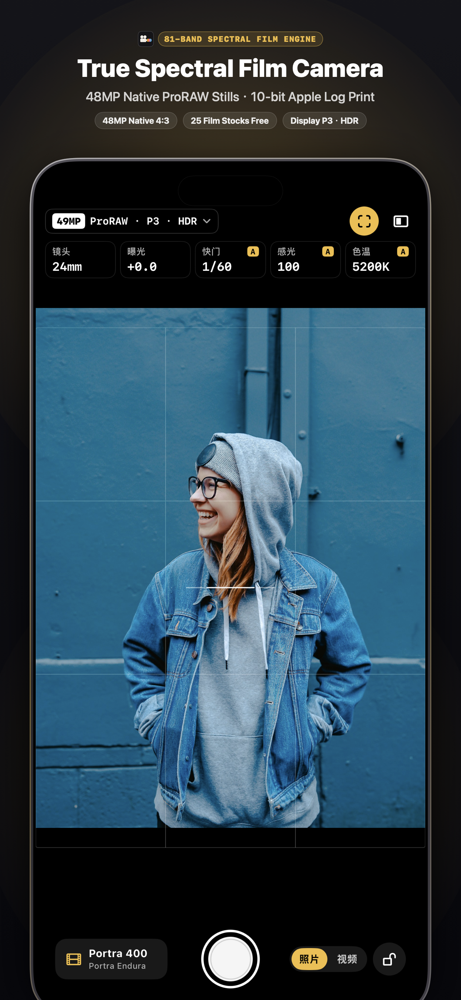
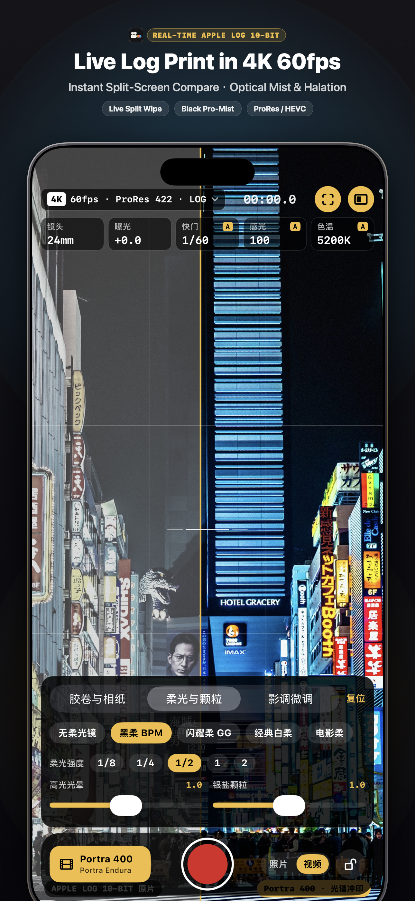
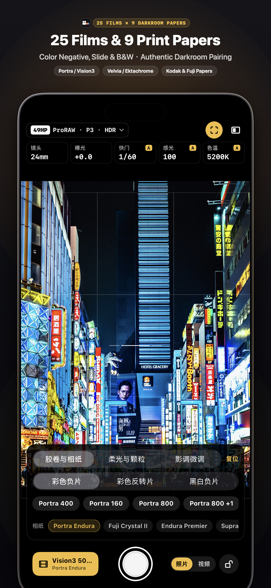

# SpekraVideo

**English** · [简体中文](README.zh-CN.md)

A real-time spectral film and darkroom print camera for iPhone. Point the lens, pick a film stock and a darkroom paper, and record 10-bit Apple Log video or 48 MP RAW still photographs developed through an 81-wavelength physical emulsion pipeline in real time.

<p align="center">
  
  
  
</p>

- **Spectral, not a static cube LUT.** Light is traced across 81 wavelengths (380 nm – 780 nm, 5 nm step) through the film's spectral sensitivities, characteristic density curves, DIR (Development Inhibitor Releasing) interlayer couplers, and the enlarger's dichroic filter pack onto RA-4 / motion-picture print stock.
- **10-bit Apple Log video & 48 MP RAW stills.** Captures `kCVPixelFormatType_420YpCbCr10BiPlanarVideoRange` (`x420`) 10-bit Apple Log video up to 4K 60 fps and native 4:3 12 MP / 24 MP / 48 MP Apple ProRAW, Bayer RAW (DNG) and HEIF photographs.
- **25 film stocks × 9 darkroom print media.** Includes 17 color negative stocks (Kodak Portra 160/400/800, Gold 200, Ultramax 400, Ektar 100, Fujifilm Pro 400H, C200, Superia X-Tra 400, CineStill 800T, Vision3 50D/200T/250D/500T), 4 color reversal slide stocks (Velvia 100, Provia 100F, Ektachrome 100, Kodachrome 64), and 4 B&W stocks (Tri-X 400, HP5 Plus 400, T-Max 100, Acros 100 II) paired with Kodak Endura, Fujifilm Crystal Archive Type II, Kodak Vision 2383 / Premier 2393, and Ilford Multigrade IV RC (grades 00–5).
- **Physical optical diffusion filters.** Three-stage cascaded GPU scattering models **Black Pro-Mist**, **Glimmerglass**, **Classic Pro-Mist**, and **CineBloom** in commercial grades `1/8`, `1/4`, `1/2`, `1`, and `2`, alongside exposure-domain red/amber halation return and dye-coupled film grain.
- **120 Hz magnetic detent dials.** Hardware-inspired arc zoom wheel (13 mm / 24 mm / 28 mm / 35 mm / 48 mm / 120 mm / 200 mm) and magnetic tick wheels for shutter speed, ISO, exposure compensation, Kelvin white balance, and split-screen Apple Log comparison with CoreHaptics feedback.
- **Dual-track recording & platform master presets.** Optionally record the untouched 10-bit Apple Log master alongside the developed film video, or export directly with bitrate and color-space profiles tailored for Xiaohongshu, WeChat Moments, Weibo, Qzone, Instagram, TikTok, and Threads.

## Film Stocks & Darkroom Print Media

### Film Stocks (25)

| Category | Stocks |
|---|---|
| **Color Negative (17)** | Kodak Portra 160 · Kodak Portra 400 · Kodak Portra 800 · Kodak Portra 800 (+1 / +2 Push) · Kodak Gold 200 · Kodak Ultramax 400 · Kodak Ektar 100 · Kodak Verita 200D · Fujifilm Pro 400H · Fujifilm C200 · Fujifilm Superia X-Tra 400 · CineStill 800T · Kodak Vision3 500T · Kodak Vision3 250D · Kodak Vision3 200T · Kodak Vision3 50D |
| **Slide / Reversal (4)** | Fujifilm Velvia 100 · Fujifilm Provia 100F · Kodak Ektachrome 100 · Kodak Kodachrome 64 |
| **Black & White (4)** | Kodak Tri-X 400 · Ilford HP5 Plus 400 · Kodak T-Max 100 · Fujifilm Neopan Acros 100 II |

### Print Papers & Lab Stocks (9)

| Category | Media |
|---|---|
| **RA-4 Color Papers (6)** | Kodak Portra Endura · Fujifilm Crystal Archive Type II · Kodak Endura Premier · Kodak Supra Endura · Kodak Ultra Endura · Kodak Ektacolor Edge |
| **Motion-Picture Print Stocks (2)** | Kodak Vision Color Print 2383 · Kodak Vision Premier 2393 |
| **Variable-Contrast B&W Paper (1)** | Ilford Multigrade IV RC (Filter Grades `00`, `0`, `1`, `2`, `3`, `4`, `5`) |

## Build from Source

Requires Xcode 16 or later and an iPhone running iOS 18.0 or later (iPhone 15 Pro / 16 Pro or later required for hardware 10-bit Apple Log recording).

1. Clone this repository:

```bash
git clone <repository-url>
cd SpekraVideo
```

2. Open `SpekraVideo.xcodeproj` in Xcode, select the **SpekraVideo** target, go to **Signing & Capabilities**, choose your own **Team**, and set a unique **Bundle Identifier** to sign and install onto your device.

3. Or build for the iOS Simulator from the command line:

```bash
xcodebuild -project SpekraVideo.xcodeproj \
           -scheme SpekraVideo \
           -sdk iphonesimulator \
           -derivedDataPath build/DerivedData \
           CODE_SIGNING_ALLOWED=NO build
```

## Layout

| Path | Description |
|---|---|
| `SpekraVideo/Sources/` | SwiftUI camera interface, `AVCaptureSession` 10-bit Apple Log & 48 MP ProRAW pipeline, Metal render engine, and C++/Objective-C++ bridge |
| `SpekraVideo/Resources/SpectralFilmShaders.msl` | Metal compute kernels for Apple Log / PQ / HLG / sRGB decoding, quarter-resolution exposure prepass, 3D print LUT baking, halation, grain, and 3-stage optical diffusion filters |
| `SpekraVideo/Resources/engine/` | Baked spectral constants (`spektrafilm_constants.bin`), 25 film & 9 paper JSON profiles, neutral enlarger filter packs, and Hanatos spectral upsampling LUT (`arctic2026beta04.bin`) |
| `engine/` | C++20 spectral core ported from `SpektraLab` / `spektrafilm` (spectral upsampling, characteristic curves, DIR couplers, RA-4 printing, and CAM16-UCS gamut mapping) |

## Credits and Licence

The spectral film process model, the measured color film and paper profiles, and the RA-4 print simulation are from [**spektrafilm**](https://github.com/andreavolpato/spektrafilm) by **Andrea Volpato**.

The C++20 port of the spectral core (`engine/src/core/`) and the 4 measured black-and-white film profiles (`kodak_tri_x_400`, `ilford_hp5_plus_400`, `kodak_tmax_100`, `fujifilm_neopan_acros_100_ii`, and `ilford_multigrade_iv_rc`) are from [**SpektraLab**](https://github.com/JamesQiu2005/SpektraLab) by **Hanze Qiu**.

| Component | Licence |
|---|---|
| Application & C++/Metal engine code | [GPL-3.0-or-later](LICENSE.txt) |
| Film and paper profiles, baked LUTs | [CC BY-SA 4.0](https://creativecommons.org/licenses/by-sa/4.0/) |

If you use this work in research, plugins, or derivative software, please cite Andrea Volpato's upstream [`spektrafilm`](https://github.com/andreavolpato/spektrafilm) project as specified in [`CITATION.cff`](CITATION.cff).

## Trademark & Branding

Pursuant to Section 7 of the GNU General Public License v3.0, the **SpekraVideo™** name, brand identity, and application icon (`logos/SpekraVideo_AppIcon_1024.png` and `Assets.xcassets/AppIcon.appiconset`) are **not** licensed under the GPL and remain reserved.

Forks for personal study and modification are welcome. However, if you distribute or publish any modified or unmodified build to others—whether free or commercial—you must remove the **SpekraVideo** name and application icon, replace them with your own distinct branding, and clearly state that your build is unofficial and not endorsed by or affiliated with SpekraVideo.
