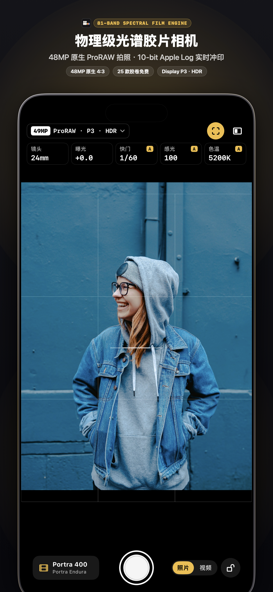
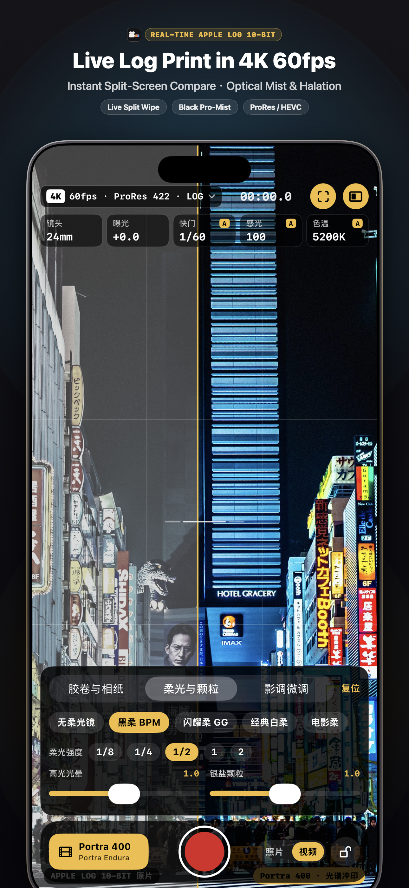
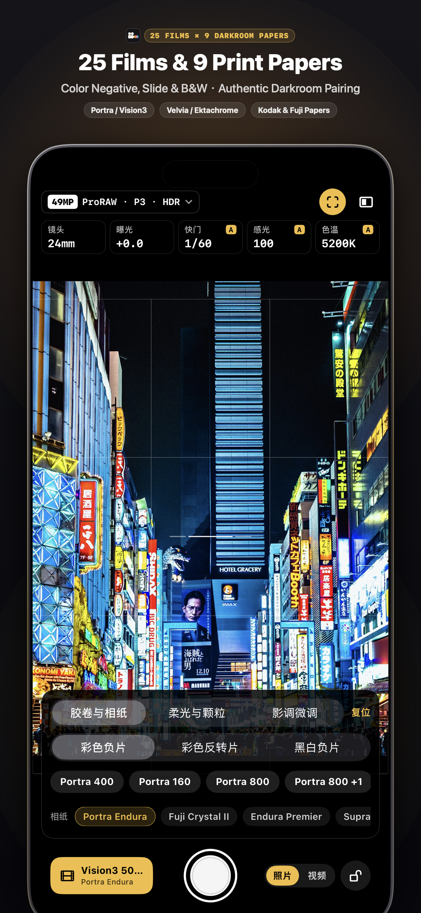

# SpekraVideo

[English](README.md) · **简体中文**

iPhone 上的实时光谱胶片与暗房相纸摄影机。选定胶卷与放大相纸，以 81 个波长的物理感光与化学显影管线，实时拍摄 10-bit Apple Log 视频与 4800 万像素 RAW 照片。

<p align="center">
  
  
  
</p>

- **81 波长光谱计算，不是静态 LUT。** 光线在 380 nm – 780 nm（5 nm 步进）的 81 个光谱波段上穿过胶片各感光层、特征密度曲线、DIR（显影抑制剂释放）层间耦合矩阵与放大机双色滤光片，投射到 RA-4 彩色相纸或电影拷贝正片上完成显影。
- **10-bit Apple Log 视频与 4800 万像素原生 4:3 拍照。** 支持录制最高 4K 60 fps 的 `x420` 10-bit Apple Log 视频（HEVC 50/100 Mbps 及 Apple ProRes 422），以及 12MP / 24MP / 48MP 的 Apple ProRAW、Bayer RAW（DNG）与 HEIF 静态照片。
- **25 款实测胶卷 × 9 款暗房冲印介质。** 涵盖 17 款彩色负片（Kodak Portra 160/400/800、Gold 200、Ultramax 400、Ektar 100、Fujifilm Pro 400H、C200、X-Tra 400、CineStill 800T、Vision3 50D/200T/250D/500T）、4 款彩色反转片（Velvia 100、Provia 100F、Ektachrome 100、Kodachrome 64）与 4 款黑白负片（Tri-X 400、HP5 Plus 400、T-Max 100、Acros 100 II），可任意配对 Kodak Endura、Fujifilm Crystal Archive II、Kodak Vision 2383 / 2393 电影拷贝片及 Ilford Multigrade IV RC（00–5 号可变反差号数）。
- **物理镜头柔光滤镜与片基反光光晕。** 基于三级级联 GPU 光学散射核模拟 **Black Pro-Mist（黑柔）**、**Glimmerglass（闪耀柔）**、**Classic Pro-Mist（经典白柔）** 与 **CineBloom（电影柔）** 四大柔光镜族（`1/8, 1/4, 1/2, 1, 2` 五档强度），并还原防光晕层去除后的高光红橙散射（Halation）与成色剂耦合胶片颗粒。
- **120 Hz 磁力刻度波轮。** 提供多焦段弧形变焦轮盘（13 mm / 24 mm / 28 mm / 35 mm / 48 mm / 120 mm / 200 mm）与快门、感光度、曝光补偿、色温及 Apple Log 实时分屏对比拨轮，配合 CoreHaptics 机械刻度震动反馈。
- **双轨原片同存与平台直出规格。** 支持在录制冲印成片的同时保存 10-bit Apple Log 原始底片，并提供针对小红书、微信朋友圈、微博、QQ空间、Instagram、TikTok 与 Threads 的防二次压制导出预设。

## 胶卷与暗房相纸清单

### 胶卷（共 25 款）

| 类别 | 胶卷型号 |
|---|---|
| **彩色负片（17 款）** | Kodak Portra 160 · Kodak Portra 400 · Kodak Portra 800 · Kodak Portra 800 (+1 / +2 迫冲) · Kodak Gold 200 · Kodak Ultramax 400 · Kodak Ektar 100 · Kodak Verita 200D · Fujifilm Pro 400H · Fujifilm C200 · Fujifilm Superia X-Tra 400 · CineStill 800T · Kodak Vision3 500T · Kodak Vision3 250D · Kodak Vision3 200T · Kodak Vision3 50D |
| **彩色反转片（4 款）** | Fujifilm Velvia 100 · Fujifilm Provia 100F · Kodak Ektachrome 100 · Kodak Kodachrome 64 |
| **黑白负片（4 款）** | Kodak Tri-X 400 · Ilford HP5 Plus 400 · Kodak T-Max 100 · Fujifilm Neopan Acros 100 II |

### 暗房相纸与电影拷贝片（共 9 款）

| 类别 | 介质型号 |
|---|---|
| **RA-4 彩色放大相纸（6 款）** | Kodak Portra Endura · Fujifilm Crystal Archive Type II · Kodak Endura Premier · Kodak Supra Endura · Kodak Ultra Endura · Kodak Ektacolor Edge |
| **电影放映拷贝正片（2 款）** | Kodak Vision Color Print 2383 · Kodak Vision Premier 2393 |
| **可变反差黑白相纸（1 款）** | Ilford Multigrade IV RC（支持 `00`、`0`、`1`、`2`、`3`、`4`、`5` 七档反差号数） |

## 从源码构建

需要 Xcode 16 或更高版本，以及运行 iOS 18.0 或更高版本的 iPhone（开启硬件 10-bit Apple Log 录制需 iPhone 15 Pro / 16 Pro 或更新机型）。

1. 克隆本仓库：

```bash
git clone <repository-url>
cd SpekraVideo
```

2. 使用 Xcode 打开 `SpekraVideo.xcodeproj`，选中 **SpekraVideo** 目标，在 **Signing & Capabilities** 中选择你自己的 Apple ID 签名团队（**Team**），并修改为你自己的 **Bundle Identifier**，即可连接真机签名安装。

3. 或通过命令行构建模拟器版本：

```bash
xcodebuild -project SpekraVideo.xcodeproj \
           -scheme SpekraVideo \
           -sdk iphonesimulator \
           -derivedDataPath build/DerivedData \
           CODE_SIGNING_ALLOWED=NO build
```

## 目录结构

| 路径 | 说明 |
|---|---|
| `SpekraVideo/Sources/` | SwiftUI 相机界面、`AVCaptureSession` 10-bit Apple Log 与 48MP ProRAW 采集管线、Metal 实时渲染引擎与 C++ 桥接层 |
| `SpekraVideo/Resources/SpectralFilmShaders.msl` | Metal 计算着色器（Apple Log / PQ / HLG / sRGB 解码、1/4 分辨率曝光预通道、3D 印相查找表烘焙、光晕散射、颗粒合成与三级级联光学柔光镜） |
| `SpekraVideo/Resources/engine/` | 预烘焙光谱常数（`spektrafilm_constants.bin`）、25 款胶卷与 9 款相纸实测配置、放大机中性滤色值与 Hanatos 光谱升采样表（`arctic2026beta04.bin`） |
| `engine/` | 移植自 `SpektraLab` / `spektrafilm` 的 C++20 光谱核心计算模块（光谱升采样、特征曲线、DIR 成色剂耦合、RA-4 印相与 CAM16-UCS 色域映射） |

## 致谢与开源许可

胶片物理过程模型、彩色胶片与相纸实测光谱配置以及 RA-4 印相模拟来自 **Andrea Volpato** 的 [**spektrafilm**](https://github.com/andreavolpato/spektrafilm)。

C++20 光谱核心移植代码（`engine/src/core/`）及 4 款黑白胶片/相纸实测配置（`kodak_tri_x_400`、`ilford_hp5_plus_400`、`kodak_tmax_100`、`fujifilm_neopan_acros_100_ii` 与 `ilford_multigrade_iv_rc`）来自 **Hanze Qiu** 的 [**SpektraLab**](https://github.com/JamesQiu2005/SpektraLab)。

| 模块 | 开源许可协议 |
|---|---|
| 应用程序与 C++/Metal 引擎代码 | [GPL-3.0-or-later](LICENSE.txt) |
| 胶片与相纸光谱配置数据、烘焙查找表 | [CC BY-SA 4.0](https://creativecommons.org/licenses/by-sa/4.0/) |

如在学术研究、插件或衍生软件中使用本项目，请按 [`CITATION.cff`](CITATION.cff) 中的说明引用上游 Andrea Volpato 的 [`spektrafilm`](https://github.com/andreavolpato/spektrafilm) 项目。

## 商标与品牌标识声明

依据 GNU 通用公共许可证第 3 版（GPL-3.0）第 7 条附加条款，**SpekraVideo™** 名称、品牌标识及应用图标（`logos/SpekraVideo_AppIcon_1024.png` 与 `Assets.xcassets/AppIcon.appiconset`）**不在**开源许可授权范围内，保留全部权利。

欢迎基于本项目进行个人学习、研究与修改。但如果你向他人分发或发布任何构建版本（无论免费或商业用途），均须移除 **SpekraVideo** 名称与应用图标，换用你自己的独立名称与图标，并在显著位置标明该版本并非官方版本、亦未获得 SpekraVideo 官方认可。
